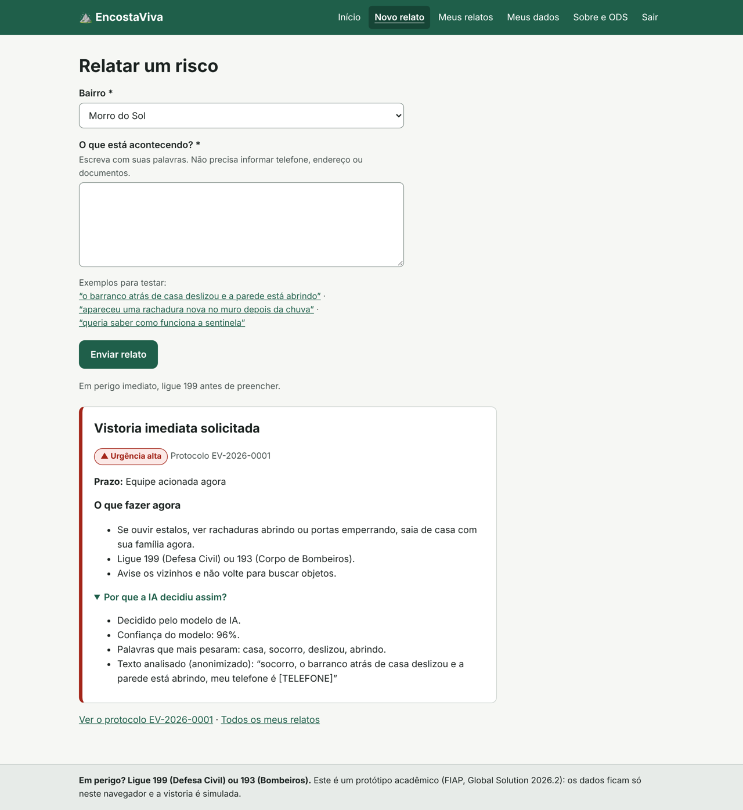
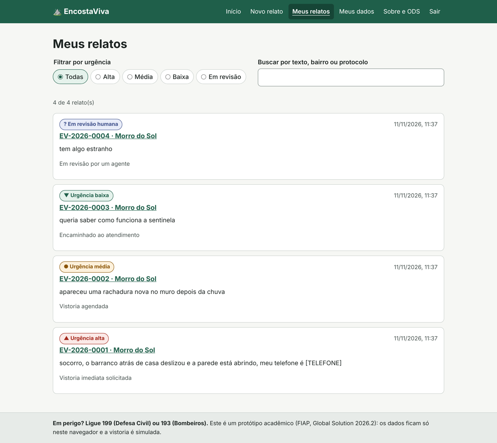
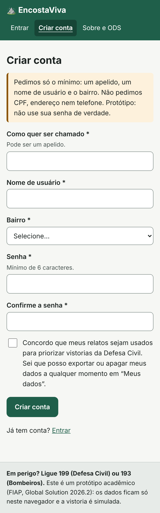

# EncostaViva Cidadão

**Protótipo Integrado CitizenTech com IA para Apoiar o Cidadão**
FIAP · Tecnologia em Inteligência Artificial · 2º ano · Front End & Mobile Development · Global Solution 2026.2

## Integrantes

| Nome completo | RM |
|---|---|
| Rafael Tavares | 567357 |
| Gabriel Muniz | 568237 |

## Problema escolhido

Cerca de **8,2 milhões de brasileiros vivem em 27.660 áreas de risco** de deslizamento, segundo o Cemaden. Na tragédia
de Petrópolis, em fevereiro de 2022, 233 pessoas morreram. Depois de uma chuva forte, quem mora na encosta vê os sinais
primeiro (uma rachadura que abre, água barrenta saindo do chão), mas não sabe se é grave nem o que fazer. A Defesa Civil,
por sua vez, recebe muitos relatos ao mesmo tempo e precisa decidir rápido onde vistoriar primeiro.

## Público afetado

* **Moradores de encostas em áreas de risco**, em geral comunidades de baixa renda, que precisam de orientação imediata e simples.
* **Equipes da Defesa Civil municipal**, que precisam de relatos organizados por urgência.

## A solução

O morador descreve, com suas palavras, o que está vendo. A **IA**:

1. **esconde dados pessoais** (telefone, e-mail e CPF viram `[TELEFONE]`, `[EMAIL]`, `[CPF]`) antes de salvar;
2. **classifica a urgência** do relato (alta, média ou baixa);
3. **gera a ação e a orientação**: vistoria imediata (com "saia de casa e ligue 199"), vistoria agendada, encaminhamento ao atendimento ou **revisão por um agente** quando não tem certeza;
4. **explica a decisão**: confiança do modelo e palavras que mais pesaram.

Faz parte do projeto **EncostaViva**, em que sentinelas com memristor cravadas nas encostas guardam a "dose" de eventos
de instabilidade do solo. A tela inicial mostra a leitura simulada das sentinelas de cada bairro.

| Resultado da IA | Consulta com filtros | Celular |
|---|---|---|
|  |  |  |

## Como executar

Requisitos: Node.js 18 ou superior.

```bash
npm install
npm run dev        # abre em http://localhost:5173
```

Outros comandos:

```bash
npm run build      # gera a versão de produção em dist/
npm run preview    # serve a versão de produção
npm run lint       # verificação de código (ESLint)
npm run validar    # mede o desempenho da IA em relatos que ela nunca viu
```

Para testar: crie uma conta em **Criar conta**, vá em **Novo relato** e use um dos exemplos prontos abaixo do campo de texto.

## Funcionalidades pedidas e onde estão

| Requisito | Onde |
|---|---|
| Componentes, props e estado | `src/components/`: `Campo`, `SeloUrgencia`, `CartaoRelato` e `ResultadoIA` recebem props; formulários, filtros e resultado usam `useState`, `useMemo` e `useRef`; sessão global com Context (`AuthContext`) |
| Rotas de navegação | `src/App.jsx` com React Router: `/login`, `/cadastro`, `/`, `/relatos/novo`, `/relatos`, `/relatos/:id`, `/privacidade`, `/sobre` e página 404. Rotas internas protegidas por `RotaProtegida` |
| Login local | `src/services/armazenamento.js`: senha guardada só como hash SHA-256 com sal (Web Crypto). Sessão no `sessionStorage` |
| Cadastro e consulta com persistência | Cadastro de usuário e de relatos; consulta com filtro por urgência, busca por texto e tela de detalhe. Tudo no `localStorage` (os dados continuam após recarregar a página) |
| Processamento inteligente e resposta | `src/services/ia.js`: anonimização, classificador Naive Bayes, regra de segurança e revisão humana. `ResultadoIA` mostra a ação gerada e a explicação |

## Como a IA funciona

A IA roda **inteiramente no navegador**: o texto do cidadão não é enviado para nenhum servidor.

1. **Anonimização** com expressões regulares (telefone, e-mail e CPF).
2. **Classificador Naive Bayes multinomial**, implementado do zero em JavaScript, com palavras e pares de palavras e treinado com 62 relatos rotulados (`src/data/treino.js`).
3. **Regra de segurança**: termos de perigo imediato ("desabou", "soterrado", "deslizamento"...) sempre geram urgência alta, mesmo que o modelo discorde.
4. **Revisão humana**: com texto curto demais ou confiança abaixo de 60%, a IA não decide sozinha.

## Evidências de validação

`npm run validar` testa a IA com **36 relatos escritos à mão que não estão no treino**, em linguagem livre, com gíria,
frases ambíguas e negação ("nenhuma rachadura por aqui"):

| Métrica | Resultado |
|---|---|
| Relatos decididos pela IA | 26 de 36 (72%) |
| Enviados para revisão humana | 10 de 36 (28%) |
| Acertos entre os decididos | 26 de 26 |
| Emergências rebaixadas (alta classificada como média ou baixa) | 0 de 12 |

**Leitura honesta do resultado:** a amostra é pequena e sintética, então o número de acertos é um indicativo e não uma
garantia. A IA é cautelosa: quando a frase foge do que ela conhece, ela manda para um agente em vez de arriscar. O custo
é que cerca de 1 em cada 4 relatos ainda precisa de leitura humana. Com relatos reais rotulados, esse número cairia.

Teste de ponta a ponta no navegador (Playwright): cadastro com validação, login, senha errada recusada, rota protegida,
relato com anonimização, os quatro tipos de resposta, filtro, busca, persistência após recarregar e layout no celular,
todos aprovados.

## Acessibilidade

* Verificação automática com **axe-core** em todas as telas: **nenhuma violação WCAG 2 A/AA**.
* Link "Pular para o conteúdo"; navegação completa por teclado com foco sempre visível.
* Cada campo tem rótulo ligado; dicas e erros são anunciados por leitores de tela (`aria-describedby`, `role="alert"`).
* Ao trocar de tela, o foco vai para o conteúdo e o título da aba muda. O resultado da IA é anunciado (`aria-live`).
* A urgência é mostrada por **texto e ícone**, não só por cor; contraste mínimo de 4,5:1; layout responsivo; `lang="pt-BR"`.

## Proteção de dados pessoais (LGPD)

* **Minimização:** a conta pede só apelido, nome de usuário e bairro. Nada de CPF, endereço ou telefone.
* **Anonimização antes de salvar:** o texto original com dados pessoais nunca é guardado. O app avisa o cidadão antes de enviar.
* **Senha** guardada só como hash com sal.
* **Consentimento** explícito no cadastro.
* **Direitos do titular:** na tela "Meus dados", o cidadão baixa uma cópia de tudo (JSON) ou apaga a conta e os relatos.
* **Nada sai do aparelho:** dados e IA ficam no navegador.

## Relação com os ODS

| ODS | Contribuição |
|---|---|
| **11. Cidades e comunidades sustentáveis** | Meta 11.5: reduzir mortes e afetados por desastres, com o relato virando prioridade de vistoria em segundos |
| **13. Ação contra a mudança global do clima** | Meta 13.1: resiliência a riscos climáticos; chuvas extremas são o gatilho dos deslizamentos |
| **3. Saúde e bem-estar** | Orientação imediata (sair de casa, ligar 199) reduz mortos e feridos |
| **10. Redução das desigualdades** | Gratuito, funciona no celular e foi feito para as comunidades que mais vivem em áreas de risco |
| **9. Indústria, inovação e infraestrutura** | IA embarcada no navegador e sentinelas com memristor como infraestrutura de alerta |

## Estrutura

```
src/
  components/   Layout, RotaProtegida, Campo, SeloUrgencia, CartaoRelato, ResultadoIA
  context/      AuthContext (sessão do usuário)
  data/         treino.js (exemplos da IA), bairros.js (sentinelas simuladas)
  pages/        Login, Cadastro, Inicio, NovoRelato, Relatos, DetalheRelato, Privacidade, Sobre, NaoEncontrada
  services/     ia.js (IA de triagem), armazenamento.js (localStorage e login local)
scripts/
  validacao.js  avaliação da IA com relatos inéditos
docs/telas/     capturas de tela
```

## Limitações

* Protótipo acadêmico: a vistoria e o acionamento da Defesa Civil são **simulados**, e as leituras das sentinelas são fictícias.
* O login local protege a conta só neste navegador. Não é um sistema de autenticação para produção.
* A IA foi treinada com poucos exemplos sintéticos e não entende negação ("nenhuma rachadura") nem ironia.

## Fontes

* Cemaden: áreas de risco no Brasil ([Correio Braziliense](https://www.correiobraziliense.com.br/brasil/2022/05/5011789-brasil-tem-mais-de-27-mil-areas-de-risco-de-desastres.html))
* Petrópolis 2022 ([O Povo](https://www.opovo.com.br/noticias/brasil/2023/02/15/apos-um-ano-petropolis-ainda-se-recupera-da-maior-tragedia-da-cidade.html))
